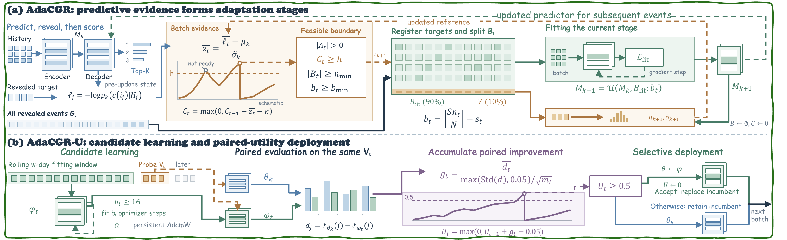

# AdaCGR

Anonymous release of the method-level code accompanying the paper
**Adaptive Stage Formation for Continual Generative Recommendation**.

## Scope

This repository contains the public policy components of AdaCGR:

- `MeanCUSUMSignal` maintains the current calibrated loss reference and accumulates predictive surprise with the paper's one-sided mean-CUSUM statistic.
- `AdaptiveStageController` applies the causal feedback and computation guards used when accepting a stage boundary.
- `PairedUtilitySignal` accumulates standardized paired loss reductions for AdaCGR-U candidate replacement.

The policies are model-agnostic. They operate on losses, user identifiers, and
small counts supplied by a caller that owns the recommender and data pipeline.
The repository includes a synthetic demonstration and tests for the temporal and
state-transition invariants.

## Method Overview



The upper panel shows predictive-surprise accumulation, adaptive stage
formation, fitting, and recalibration. The lower panel shows persistent
candidate learning, paired evaluation, and selective replacement.

## Repository Layout

```text
adacgr/
  clock.py       Predictive-surprise clock and stage controller
  utility.py     Paired candidate-utility clock
examples/
  demo.py        Synthetic, data-free example
scripts/
  run_adacgr_learner.sh  Learner-specific AdaCGR wrapper
  run_adacgr_ft.sh       AdaCGR-FT wrapper
  run_adacgr_lsat.sh     AdaCGR-LSAT wrapper
  run_adacgr_reformer.sh AdaCGR-Reformer wrapper
  run_adacgr_peso.sh     AdaCGR-PESO wrapper
  run_adacgr_dact.sh     AdaCGR-DACT wrapper
  run_adacgr_u.sh        AdaCGR-U wrapper
  run_reference_screen.sh Full learner reference wrapper
  run_reference_u.sh     AdaCGR-U reference wrapper
  demo.sh                Demo wrapper
  test.sh                Test wrapper
  fixtures/              Small anonymous JSON fixtures
tests/
  test_policies.py
```

Run the demo from the repository root:

```sh
sh scripts/demo.sh
```

## Installation

Python 3.10 or newer is recommended.

```sh
sh scripts/setup.sh
```

## Tests

```sh
sh scripts/test.sh
```

## Runnable Experiment Scripts

The public scripts replay the method policies from saved chronological losses.
They do not contain a recommender backbone or private data loader.

### AdaCGR-FT (Ours)

```sh
sh scripts/run_adacgr_ft.sh \\
  scripts/fixtures/adacgr_x_toy.json \\
  outputs/adacgr_ft_toy.json
```

### AdaCGR-LSAT (Ours)

```sh
sh scripts/run_adacgr_lsat.sh \\
  scripts/fixtures/adacgr_x_toy.json \\
  outputs/adacgr_lsat_toy.json
```

### AdaCGR-Reformer (Ours)

```sh
sh scripts/run_adacgr_reformer.sh \\
  scripts/fixtures/adacgr_x_toy.json \\
  outputs/adacgr_reformer_toy.json
```

### AdaCGR-PESO (Ours)

```sh
sh scripts/run_adacgr_peso.sh \\
  scripts/fixtures/adacgr_x_toy.json \\
  outputs/adacgr_peso_toy.json
```

### AdaCGR-DACT (Ours)

```sh
sh scripts/run_adacgr_dact.sh \\
  scripts/fixtures/adacgr_x_toy.json \\
  outputs/adacgr_dact_toy.json
```

Each command uses the same adaptive stage policy with a different learner
label. In a full run, the supplied learner must produce the corresponding
chronological loss batches and post-fit calibration tails.

### AdaCGR-U (Ours)

AdaCGR-U keeps candidate learning outside the gate, evaluates incumbent and
candidate on the same held-out windows, and uses paired utility to decide
whether to deploy the candidate.

Run the anonymous fixture:

```sh
sh scripts/run_adacgr_u.sh \\
  scripts/fixtures/adacgr_u_toy.json \\
  outputs/adacgr_u_toy.json
```

The report records paired gains, accumulated evidence, and deployment windows.
The caller must perform candidate optimization and provide the resulting paired
loss vectors; the public script only replays the deployment policy.

### Full Reference Experiments

The complete paper experiments are intentionally not bundled because they
require the reference model code, real chronological inputs, checkpoints, and
an allocated CUDA device. Keep those components in a private reference
workspace and invoke the existing reference entrypoints there.

The complete paper experiments use private reference workspaces. Set the
workspace variables before invoking the reference wrappers:

```sh
export ADACGR_X_REFERENCE=/path/to/adacgr-backbone-reference
export ADACGR_U_REFERENCE=/path/to/adacgr-u-reference
export REMOTE_OUTPUT_ROOT=/absolute/path/for/experiment-outputs
```

For the complete paper experiments, the existing reference `run_screen.py`
produces the fixed-schedule baseline and the adaptive conditions in one run.
`periodic28` is the `Recent-FT` condition; the `mean_*` conditions report the
AdaCGR learner variant.

The `ft` invocation therefore covers both `Recent-FT` and `AdaCGR-FT`:

```sh
sh scripts/run_reference_screen.sh ft Beauty early b1 2025
```

Run the other learner variants separately:

```sh
# AdaCGR-LSAT
sh scripts/run_reference_screen.sh lsat Beauty early b1 2025

# AdaCGR-Reformer
sh scripts/run_reference_screen.sh reformer Beauty early b1 2025

# AdaCGR-PESO
sh scripts/run_reference_screen.sh peso Beauty early b1 2025

# AdaCGR-DACT
sh scripts/run_reference_screen.sh dact Beauty early b1 2025
```

The complete runner requires the reference model, real inputs, checkpoints and
CUDA. The public replay commands above only validate the policy layer.

For AdaCGR-U, the reference entrypoint is `run_u.py`. The smoke phase is the
small registered fixture; prefix runs are used for selection, and full runs
consume a frozen selection file:

```sh
# Smoke fixture
sh scripts/run_reference_u.sh smoke Beauty 2025 early baseline

# Prefix selection
sh scripts/run_reference_u.sh prefix Beauty 2025 early baseline

# Full run with a frozen selection file
sh scripts/run_reference_u.sh full Beauty 2025 full_suffix "$SELECTED_PROFILE" "$FROZEN_SELECTION_JSON"
```

`REMOTE_OUTPUT_ROOT` must be an absolute path on the execution machine. The
reference runners validate their source and input receipts before training;
do not replace the input, model, or checkpoint paths with local toy files when
claiming a paper reproduction.

## Minimal Usage

```python
from adacgr import AdaptiveStageController, MeanCUSUMSignal
    threshold=2.0,
    tolerance=0.1,
    variance_floor=0.05**2,
)
clock.calibrate(prefix_losses)
controller = AdaptiveStageController(
    clock,
    min_feedback=256,
    min_budget=16,
)

for losses in chronological_batches:
    decision = controller.observe_batch(
        losses,
        feedback_count=len(losses),
        eligible_count=count_eligible_events(),
        available_steps=available_training_steps(),
    )
    if decision.accepted:
        fit_model_on_causal_buffer()
        post_fit_tail = collect_reserved_post_fit_tail()
        controller.complete_fit(post_fit_tail)
```

For AdaCGR-U, evaluate the incumbent and candidate on the same held-out
interactions and call `PairedUtilitySignal.observe` with the two loss vectors and
the corresponding user identifiers. Deploy the candidate only when it returns
`replace=True`, then call `reset_after_replacement`.

The reference is consulted before each observation is incorporated and remains
fixed within a stage. After fitting, the caller must recalibrate it on a
reserved post-fit tail through `complete_fit(post_fit_calibration_losses)`. The
caller must preserve chronological prediction-before-learning order and must
not use future feedback to construct a boundary decision.
